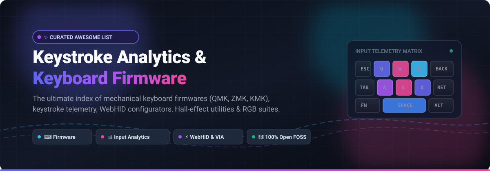

  

# ⌨️ Awesome Keystroke Analytics & Keyboard Firmware

  
  
  
  
  

> 🌟 **Top Keystroke Analytics & Mechanical Keyboard Firmware (Open-Source & SaaS)** 🌟  
> A comprehensive, SEO-optimized curated directory of high-performance mechanical keyboard firmwares (QMK, ZMK, KMK, RMK), keystroke analytics trackers, typing telemetry heatmaps, WebHID configurators, Hall-effect / Rapid Trigger utilities, OS-level remappers, and unified RGB lighting control suites.

---

## 📑 Table of Contents

- [📈 Sector Overview & Market Dynamics](#-sector-overview--market-dynamics)
- [☁️ SaaS & Proprietary Keyboard Ecosystems](#️-saas--proprietary-keyboard-ecosystems)
- [🔓 Open-Source Equivalents & Utilities](#-open-source-equivalents--utilities)
  - [📊 Keystroke Analytics, Heatmaps & Typing Telemetry](#-keystroke-analytics-heatmaps--typing-telemetry)
  - [⌨️ Open-Source Mechanical Keyboard Firmwares](#️-open-source-mechanical-keyboard-firmwares)
  - [🎛️ Web & Desktop Keymap Configurators](#️-web--desktop-keymap-configurators)
  - [🔄 Key Remappers, Macro Engines & Input Layers](#-key-remappers-macro-engines--input-layers)
  - [💡 RGB Lighting & Hardware Synchronization](#-rgb-lighting--hardware-synchronization)
- [🤝 Contributing](#-contributing)
- [💖 Support & Sponsorship](#-support--sponsorship)
- [⭐ Star History](#-star-history)

---

## 📈 Sector Overview & Market Dynamics

The global computer peripherals and mechanical keyboard software market is valued at approximately **$5.4 Billion USD** (growing at an estimated 8.5% CAGR), driven by competitive eSports, mechanical keyboard enthusiast culture, ergonomics, and remote productivity telemetry. The market dynamics reflect a **moderately fragmented ecosystem** at the hardware peripheral layer (with tier-1 legacy giants like Logitech and Razer competing alongside agile enthusiast innovators like Wooting, Keychron, and Glorious), yet exhibits a **winner-take-most concentration** in cloud-sync software lock-in and open-source firmware protocols—where QMK, ZMK, and VIA act as standard open protocols, while proprietary vendor suites tie hardware configuration to closed desktop cloud environments.

---

## ☁️ SaaS & Proprietary Keyboard Ecosystems

The following table provides a comparison of major commercial peripheral ecosystems, WebHID software suites, and manufacturer cloud platforms. Sorted by estimated company scale (Revenue / Valuation in descending order).

| Product / Ecosystem | Company Size (Revenue / Valuation) | Pricing Tier (USD) | Free Tier Limits / Evaluation Period | Core Capabilities & Telemetry |
| :--- | :--- | :--- | :--- | :--- |
| **[Logitech G HUB](https://logitechg.com)** | **~$4.30B Revenue** (Logitech Int. NASDAQ: LOGI) | **Free with Hardware** ($29.99 min device purchase for base G-series hardware) | **Unlimited lifetime free** for all owners; zero subscription fees; requires Logitech G hardware pairing; cloud sync up to 15 custom onboard profiles per device | Cloud profile sync, LIGHTSYNC RGB animations, G-Key multi-action macro engine, Discord/OBS SDK integrations |
| **[Razer Synapse & Synapse Web](https://razer.com)** | **~$2.10B Revenue** (Razer Inc. Private / Pre-IPO Valuation) | **Free with Hardware** ($39.99 min hardware purchase for entry keyboard) | **Unlimited lifetime free** with Razer ID registration; full access to Razer Chroma RGB, macro recorder, and keystroke heatmaps; requires Razer peripheral connection | Cloud-synchronized keybindings, Chroma Studio lighting, hypershift layers, real-time keystroke heatmaps & click telemetry |
| **[Corsair iCUE](https://corsair.com)** | **~$1.35B Revenue** (Corsair Gaming NASDAQ: CRSR) | **Free with Hardware** ($49.99 min hardware purchase for entry gaming keyboard) | **Unlimited lifetime free**; unmetered access to RGB lighting patterns, custom key remaps, and fan/sensor curves; restricted to Corsair hardware ecosystem | Hardware playback profiles, Murals ambient lighting sync, slipstream wireless management, keystroke response diagnostics |
| **[SteelSeries GG (Engine)](https://steelseries.com)** | **~$450M Revenue** (Acquired by GN Store Nord for $1.25B) | **Free with Hardware** ($59.99 min hardware purchase for Apex keyboards) | **Unlimited lifetime free** with optional SteelSeries account; includes Moments video clipping and Sonar audio mixing; actuation tuning locked to Apex Pro OmniPoint hardware | OmniPoint Hall-effect analog actuation tuning (0.1mm - 4.0mm), Rapid Trigger, Prism RGB, multi-layered OLED display profiles |
| **[Epomaker Cloud Software](https://epomaker.com)** | **~$120M Valuation** (Epomaker / Skyloong Private) | **Free with Hardware** ($45.00 min keyboard purchase) | **Unlimited lifetime free** driver download; no monthly fees; key remapping and layer profiles limited to supported Epomaker/Skyloong hardware | Custom multi-layer macro editor, FN combo remapping, onboard RGB profile flashing, wireless 2.4GHz/BLE pairing |
| **[Ducky Hub / Ducky RGB](https://duckychannel.com.tw)** | **~$90M Valuation** (DuckyChannel International) | **Free with Hardware** ($79.00 min keyboard purchase for One 2/3 series) | **Unlimited lifetime free** standalone executable; no cloud registration required; settings stored directly to physical keyboard EEPROM | Onboard hardware macro recording, per-key RGB backlighting presets, DIP switch profile management |
| **[Glorious CORE](https://gloriousgaming.com)** | **~$80M Valuation** (Glorious LLC Private) | **Free with Hardware** ($69.99 min hardware purchase for GMMK keyboards) | **Unlimited lifetime free** desktop utility; up to 3 onboard hardware profiles per device; unrestricted firmware updates and polling adjustments | Polling rate selector (up to 8000Hz on supported models), per-key RGB backlighting, custom input latency debounce tuning |
| **[Wooting Wootility Web](https://wootility.io)** | **~$45M Valuation** (Wooting BV Private) | **Free with Hardware** ($174.99 min purchase for Wooting 60HE+) | **Unlimited lifetime free** WebHID web app and standalone desktop version; zero cloud paywalls; stores 4 complete analog profiles locally on keyboard memory | Rapid Trigger continuous actuation (0.1mm precision), Tachyon mode ultra-low latency, Dynamic Keystroke (DKS), Mod Tap, analog joystick emulation |
| **[QMK Configurator (Hosted)](https://qmk.fm)** | **Community Non-Profit / Open Foundation** | **$0.00 / Free** (100% Free Public Cloud Build Infrastructure) | **Unlimited lifetime free forever**; unmetered visual keymap authoring and cloud binary hex/bin firmware compilation; supported by community sponsors | Web-based visual keymap builder, JSON layout export/import, automated cloud firmware cross-compilation pipeline |
| **[VIA Web (usevia.app)](https://usevia.app)** | **Community Non-Profit / Open Standard** | **$0.00 / Free** (100% Free WebHID Service) | **Unlimited lifetime free forever**; real-time on-the-fly EEPROM dynamic key remapping without flashing; requires WebHID compatible browser (Chrome/Edge/Brave) | Dynamic real-time key remapping, multi-layer switching, custom macro editor, RGB backlight tuning over WebHID protocol |

---

## 🔓 Open-Source Equivalents & Utilities

A curated, star-ranked index of open-source mechanical keyboard firmwares, typing telemetry tools, key remapping daemons, and cross-platform RGB software. Each project features a live GitHub star badge linking directly to its stargazers.

### 📊 Keystroke Analytics, Heatmaps & Typing Telemetry

Tools for tracking typing performance, keystroke count, input heatmaps, and finger travel ergonomics.

| Project | Stars | Language | Primary Features |
| :--- | :--- | :--- | :--- |
| **[Monkeytype](https://github.com/monkeytypegame/monkeytype)** |  | TypeScript / CSS | Highly customizable, open-source typing speed test featuring detailed WPM telemetry, burst metrics, error heatmaps, and custom themes. |
| **[ActivityWatch](https://github.com/ActivityWatch/activitywatch)** |  | Python / Rust / Vue | Privacy-focused automated activity tracker logging active window usage, keystroke frequencies, and productivity metrics locally with zero cloud leakage. |
| **[Keyboard Layout Heatmap](https://github.com/jasonrudolph/keyboard-layout-heatmap)** |  | JavaScript | Generates visual keystroke density heatmaps comparing QWERTY, Dvorak, Colemak, and custom ergonomic layout efficiencies. |
| **[Keybytes](https://github.com/notaroomba/keybytes)** |  | TypeScript / React | Modern desktop keystroke analytics dashboard visualizing typing rhythms, daily key counts, and personalized heatmaps. |
| **[Oxeylyzer](https://github.com/o-x-e-y/oxeylyzer)** |  | Rust | High-speed ergonomic layout analyzer simulating finger travel effort, lateral stretches, roll frequencies, and bigram redirection penalties. |
| **[KeyStats](https://github.com/balthazar/keystats)** |  | Objective-C | Ultra-lightweight macOS menu bar counter displaying real-time daily keystroke tallies, click counts, and typing activity history. |

---

### ⌨️ Open-Source Mechanical Keyboard Firmwares

Custom firmware engines powering DIY builds, split ergonomic designs, wireless Bluetooth keyboards, and Hall-effect controllers.

| Project | Stars | Language | Primary Features |
| :--- | :--- | :--- | :--- |
| **[QMK Firmware](https://github.com/qmk/qmk_firmware)** |  | C / Makefile | The industry-standard open-source keyboard firmware with support for thousands of custom keyboards, dynamic macros, Tap-Dance, and RGB lighting. |
| **[ZMK Firmware](https://github.com/zmkfirmware/zmk)** |  | C / Zephyr RTOS | Modern wireless-first mechanical keyboard firmware built on Zephyr RTOS featuring ultra-low power Bluetooth Low Energy (BLE) and native split sync. |
| **[Miryoku](https://github.com/manna-harbour/miryoku)** |  | C / DeviceTree | Ergonomic, universal 36-key orthogonal layout specification implemented across QMK, ZMK, and KMK with home-row modifiers. |
| **[RMK](https://github.com/haobogu/rmk)** |  | Rust (Embassy) | High-performance, async keyboard firmware written in Rust with built-in BLE support, storage state persistence, and real-time Vial compatibility. |
| **[KMK Firmware](https://github.com/KMKfw/kmk_firmware)** |  | CircuitPython | Beginner-friendly, rapid-prototyping keyboard firmware written in CircuitPython; edit keymaps in real time simply by modifying a Python file. |
| **[Keyberon](https://github.com/stereobooster/keyberon)** |  | Rust (`no_std`) | Pure Rust `no_std` keyboard firmware library designed for microcontrollers, implementing matrix scanning, debouncing, and multi-layer layouts. |
| **[BlueMicro_BLE](https://github.com/jpakkane/blue-micro-firmware)** |  | C++ / Arduino | Arduino-based Bluetooth keyboard firmware designed specifically for Nordic Semiconductor nRF52-based split wireless keyboards. |

---

### 🎛️ Web & Desktop Keymap Configurators

Graphical interfaces for real-time keymapping, macro recording, layer inspection, and SVG layout rendering.

| Project | Stars | Language | Primary Features |
| :--- | :--- | :--- | :--- |
| **[Vial GUI](https://github.com/vial-kb/vial-gui)** |  | Python / PyQt | Privacy-first open-source fork of VIA offering offline desktop/WebHID configuration, Tap Dance, Combos, Key Overrides, and encrypted EEPROM unlocking. |
| **[Keymap Drawer](https://github.com/caksoylar/keymap-drawer)** |  | Python | CLI and web tool that parses QMK/ZMK keymap files and renders visual, publication-quality SVG layout diagrams automatically. |
| **[QMK Configurator](https://github.com/qmk/qmk_configurator)** |  | Vue.js / JavaScript | Complete open-source frontend powering the official QMK web configurator; supports custom keymap compilation and JSON layout sharing. |
| **[ZMK Studio](https://github.com/zmkfirmware/zmk-studio)** |  | TypeScript / WebHID | Official runtime keymap visualizer and modifier editor for ZMK-powered wireless and wired keyboards. |

---

### 🔄 Key Remappers, Macro Engines & Input Layers

OS-level keyboard interception engines bringing QMK/ZMK tap-hold, home-row modifiers, and multi-layer workflows to standard laptop and desktop keyboards.

| Project | Stars | Language | Primary Features |
| :--- | :--- | :--- | :--- |
| **[Karabiner-Elements](https://github.com/pqrs-org/Karabiner-Elements)** |  | C++ / Swift | The universal keyboard customizer and modifier remapper for macOS; features complex rule matching, virtual HID manipulation, and per-device profile switching. |
| **[AutoHotkey](https://github.com/AutoHotkey/AutoHotkey)** |  | C++ | Powerful scripting language and keyboard/mouse automation engine for Windows, enabling custom hotkeys, text expansions, and GUI automation. |
| **[Kanata](https://github.com/jtroo/kanata)** |  | Rust | Cross-platform software keyboard remapper bringing QMK-style tap-dance, layers, and home-row mods to Windows, macOS, and Linux without custom firmware. |
| **[keyd](https://github.com/rvaiya/keyd)** |  | C | Ultra-fast, low-overhead Linux keyboard remap daemon operating at kernel `evdev`/`uinput` level; zero latency system-wide layers and chords. |
| **[Input Remapper](https://github.com/sezanzeb/input-remapper)** |  | Python / GTK | Linux desktop GUI tool for remapping keys, gamepad buttons, and mouse triggers with programmable macros and custom autoloading profiles. |
| **[KMonad](https://github.com/kmonad/kmonad)** |  | Haskell | Advanced cross-platform keyboard daemon configuring multi-tap, layers, and advanced home-row mods across Linux, Windows, and macOS. |

---

### 💡 RGB Lighting & Hardware Synchronization

Cross-vendor RGB backlighting utilities that eliminate proprietary background processes and bloatware.

| Project | Stars | Language | Primary Features |
| :--- | :--- | :--- | :--- |
| **[OpenRGB](https://github.com/CalcProgrammer1/OpenRGB)** |  | C++ / Qt | Cross-platform open-source RGB lighting control suite replacing vendor bloatware (Synapse, iCUE, G HUB) across keyboards, motherboards, RAM, and GPUs. |
| **[Artemis RGB](https://github.com/Artemis-RGB/Artemis)** |  | C# / .NET | Unified open-source RGB synchronization engine providing game telemetry integrations, real-time audio visualizers, and multi-device lighting layers. |

---

## 🤝 Contributing

Contributions, feature suggestions, and updates are warmly welcomed! 🌟

1. 🍴 **Fork the repository** to your GitHub account.
2. 🌿 **Create a feature branch** (`git checkout -b feature/amazing-keyboard-utility`).
3. 📝 **Add your project** in the appropriate category with clean Markdown formatting, pricing / star badges, and concise descriptions.
4. 🚀 **Commit your changes** (`git commit -m "Add new telemetry tool"`).
5. 📬 **Open a Pull Request** explaining the benefits and features of the proposed addition.

Explore more awesome curated collections at **[Awesome-Awesome-Awesome](https://github.com/ishandutta2007/Awesome-Awesome-Awesome)**!

---

## 💖 Support & Sponsorship

If this curated guide helped you optimize your mechanical keyboard setup, custom firmware build, or typing telemetry workflows, please consider supporting ongoing maintenance!

- ⭐ **Star this repository** to help others discover it on GitHub.
- 🍴 **Fork and share** with your local mechanical keyboard and developer communities.
- ☕ **Buy me a coffee & support the developer**:
  
  

Every contribution helps keep this ecosystem index fresh, accurate, and actively maintained. Thank you for your support! ❤️

---

## ⭐ Star History

